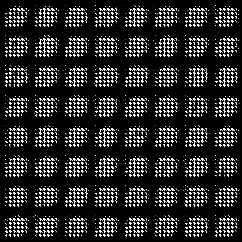
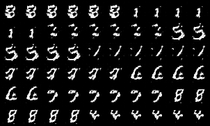
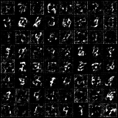
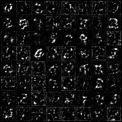
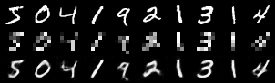

# GANs - Generative Models on MNIST in PyTorch

GAN · DCGAN · cGAN · SRGAN · VAE · VAE-GAN

Compact, readable PyTorch implementations of six generative models, all trained on **MNIST (28×28, grayscale)**. After every epoch, each training script renders a fixed set of samples. These frames are stitched into a GIF, so you can watch each model learn.

---

## Table of Contents
1. [Training Results at a Glance](#training-results-at-a-glance)
2. [Project Structure](#project-structure)
3. [Installation](#installation)
4. [Usage](#usage)
5. [Shared Training Setup](#shared-training-setup)
6. [Models](#models)
   - [GAN](#1-gan)
   - [DCGAN](#2-dcgan)
   - [cGAN](#3-cgan-conditional-gan)
   - [SRGAN](#4-srgan-super-resolution-gan)
   - [VAE](#5-vae-variational-autoencoder)
   - [VAE-GAN](#6-vae-gan)
7. [Model Comparison](#model-comparison)
8. [Outputs](#outputs)
9. [Known Issues and Fixes](#known-issues-and-fixes)

---

## Training Results at a Glance

Each GIF has one frame per epoch (100 frames, 100 ms each).

| GAN | cGAN |
|:---:|:---:|
|  |  |
| Samples from fixed noise | One row per digit, 0–9 (top to bottom) |

| VAE | VAE-GAN |
|:---:|:---:|
|  |  |
| 64 samples decoded from fixed latent vectors | Same as VAE, with an added adversarial loss |

**SRGAN** (rows from top to bottom: ground-truth HR, low-res input (7×7, upscaled for display), super-resolved output):



---

## Project Structure

```
.
├── GAN.py              # Vanilla convolutional GAN
├── DCGAN.py            # DCGAN with configurable feature widths
├── cGAN.py             # Conditional GAN (digit-label conditioning)
├── SRGAN.py            # SRGAN generator (residual blocks + PixelShuffle) and discriminator
├── VAE.py              # Variational Autoencoder (self-contained: model + training)
├── VAE-GAN.py          # VAE + adversarial discriminator (self-contained)
├── train.py            # Training script for GAN / DCGAN / cGAN
├── train_srgan.py      # Training script for SRGAN
├── data/               # MNIST (downloaded automatically)
├── models/             # Saved weights (.pth)
└── results/            # Training GIFs
    ├── gan_training.gif
    ├── cgan_training.gif
    ├── SRGAN_training.gif
    ├── vae_training.gif
    └── vae-gan_training.gif
```

---

## Installation

```bash
git clone <your-repo-url>
cd <your-repo-folder>

python -m venv venv
source venv/bin/activate          # Windows: venv\Scripts\activate

pip install torch torchvision numpy opencv-python pillow tqdm
```

A CUDA GPU is used automatically if available, otherwise training runs on the CPU. MNIST is downloaded to `./data` on first run.

> **Note:** The scripts open a live preview window with `cv2.imshow`, so they need a display. On a headless server, remove the `cv2.imshow` / `cv2.waitKey` / `cv2.destroyAllWindows` lines.

---

## Usage

### GAN, DCGAN, cGAN: `train.py`

`train.py` is shared by these three models. Choose the model at the top of the script:

```python
from GAN import GAN
from DCGAN import DCGAN
from cGAN import cGAN

implemented_gans = {"GAN": GAN, "DCGAN": DCGAN, "cGAN": cGAN}
gan_type = "cGAN"          # "GAN", "DCGAN" or "cGAN"
```
```bash
python train.py
```

### SRGAN: `train_srgan.py`
```bash
python train_srgan.py
```

### VAE and VAE-GAN
```bash
python VAE.py
python VAE-GAN.py
```

---

## Shared Training Setup

| Setting | GAN / DCGAN / cGAN (`train.py`) | SRGAN (`train_srgan.py`) | VAE | VAE-GAN |
|---|---|---|---|---|
| Dataset | MNIST | MNIST | MNIST | MNIST |
| Image size / channels | 28×28 / 1 | 28×28 / 1 | 28×28 / 1 | 28×28 / 1 |
| Pixel range | [-1, 1] (`Normalize(0.5, 0.5)`) | [-1, 1] | [-1, 1] | [-1, 1] |
| Epochs | 100 | 100 | 100 | 100 |
| Batch size | 64 | 64 | 64 | 64 |
| Learning rate | 2e-4 | 2e-4 | 2e-4 | 1e-4 |
| Optimizer | Adam (β = 0.5, 0.999) | Adam (β = 0.5, 0.999) | Adam (default β) | Adam (default β) |
| Latent dimension | 100 | – | 100 | 100 |
| Random seed | 42 | 42 | 42 | 42 |

Details:
- **Weight initialization (GAN family):** Conv, ConvTranspose and Linear weights use N(0, 0.02). BatchNorm weights use N(1, 0.02) with zero bias.
- **GAN loss:** Binary cross-entropy (`BCELoss`), with real = 1 and fake = 0.
- **Preview:** After each epoch the generator runs in `eval()` mode on a fixed input, so the frames are comparable across epochs.

---

## Models

### 1. GAN


A convolutional GAN. The generator turns a `latent_dim × 1 × 1` noise tensor into a 28×28 image. The discriminator outputs the probability that an image is real.

**Generator**

| Layer | Output shape |
|---|---|
| ConvTranspose2d(latent_dim → 256, k7, s1) + BN + ReLU | 256 × 7 × 7 |
| ConvTranspose2d(256 → 128, k4, s2, p1) + BN + ReLU | 128 × 14 × 14 |
| ConvTranspose2d(128 → 1, k4, s2, p1) + Tanh | 1 × 28 × 28 |

**Discriminator**

| Layer | Output shape |
|---|---|
| Conv2d(1 → 128, k4, s2, p1) + LeakyReLU(0.2) | 128 × 14 × 14 |
| Conv2d(128 → 256, k4, s2, p1) + BN + LeakyReLU(0.2) | 256 × 7 × 7 |
| Conv2d(256 → 1, k7) + Sigmoid | 1 × 1 × 1 |

**Training loop:** In each step, the discriminator is trained on real images and on detached fakes. Then the generator is trained to make the discriminator output "real" for its fakes.

---

### 2. DCGAN

A DCGAN-style variant with configurable channel widths (`generator_features = discriminator_features = 64` by default) and no bias terms in the convolutions. It uses the same training loop as the GAN.

**Generator**

| Layer | Output shape |
|---|---|
| ConvTranspose2d(latent_dim → 4·gf, k7) + BN + ReLU | 256 × 7 × 7 |
| ConvTranspose2d(4·gf → 2·gf, k4, s2, p1) + BN + ReLU | 128 × 14 × 14 |
| ConvTranspose2d(2·gf → gf, k4, s2, p1) + BN + ReLU | 64 × 28 × 28 |
| Conv2d(gf → 1, k3, p1) + Tanh | 1 × 28 × 28 |

**Discriminator**

| Layer | Output shape |
|---|---|
| Conv2d(1 → df, k4, s2, p1) + LeakyReLU | 64 × 14 × 14 |
| Conv2d(df → 2·df, k4, s2, p1) + BN + LeakyReLU | 128 × 7 × 7 |
| Conv2d(2·df → 4·df, k4, s2, p1) + BN + LeakyReLU | 256 × 3 × 3 |
| Conv2d(4·df → 1, k3) + Sigmoid | 1 × 1 × 1 |

---

### 3. cGAN (Conditional GAN)


Both networks receive the digit label, so you can ask the generator for a specific digit.

- **Generator:** `nn.Embedding(num_classes, latent_dim)` turns the label into a vector. It is reshaped to `latent_dim × 1 × 1` and concatenated with the noise, so the first layer takes `latent_dim * 2` channels.
- **Discriminator:** `nn.Embedding(num_classes, 28*28)` turns the label into a 28×28 map. It is concatenated to the image as an extra channel, so the first layer takes `image_channels + 1` channels.
- The convolutional body is otherwise the same as the vanilla GAN.

**Training specifics:** Fake images are generated with random labels. The preview uses `fixed_noise` (100 vectors) with `fixed_labels` (10 samples per digit). The grid has 10 columns, so **each row shows one digit, 0–9**.

---

### 4. SRGAN (Super-Resolution GAN)


SRGAN reconstructs a 28×28 image from a **7×7** version of it (upscale factor 4).

**Data flow**
1. The HR image (28×28) is downsampled with bilinear interpolation to LR (7×7).
2. The generator upsamples LR to SR (28×28).
3. The discriminator compares HR (real) against SR (fake).

**Generator**
- 9×9 Conv + PReLU for initial feature extraction.
- **16 residual blocks**, each Conv3×3 → BN → PReLU → Conv3×3 → BN, with a skip connection.
- Conv3×3 + BN, plus a long skip connection from the initial features.
- **Upsampling:** log₂(upscale_factor) = 2 blocks of Conv → PixelShuffle(2) → PReLU. This takes 7×7 to 14×14 to 28×28.
- 9×9 Conv + Tanh output.

**Discriminator**
- 8 conv blocks with 3×3 kernels. Channels go 64 → 64 → 128 → 128 → 256 → 256 → 512 → 512, with stride alternating between 1 and 2. All blocks have BN except the first. All use LeakyReLU(0.2).
- Classifier: AdaptiveAvgPool → Flatten → Linear(512 → 1024) → LeakyReLU → Linear(1024 → 1) → Sigmoid.

**Loss**

```
L_G = 1.0 · MSE(SR, HR)  +  0.001 · BCE(D(SR), real)
L_D = BCE(D(HR), real)  +  BCE(D(SR), fake)
```

The small adversarial weight (`lambda_adversarial = 0.001`) makes the pixel-wise MSE the dominant term.

**Preview:** The GIF is a 3-row grid built from the first 10 MNIST training images. The rows are HR, LR (nearest-neighbour upscaled to 28×28 for display) and SR.

---

### 5. VAE (Variational Autoencoder)


**Encoder:** Conv(1→128, k4, s2) → LeakyReLU → Conv(128→256, k4, s2) → BN → LeakyReLU. The result is flattened (256·7·7 = 12544) and fed to two linear heads: `fc_mu` and `fc_logvar` (each → 100).

**Reparameterization:** `z = μ + ε·σ`, with `σ = exp(0.5·logvar)` and `ε ~ N(0, I)`.

**Decoder:** Linear(100 → 12544) → reshape to 256×7×7 → ConvT(256→128) + BN + ReLU → ConvT(128→1) → Tanh.

**Loss (per batch, divided by batch size)**

```
L = Σ (x_recon − x)²  +  KL,   KL = −½ Σ (1 + logvar − μ² − exp(logvar))
```

**Preview:** The decoder is applied to 64 fixed latent vectors drawn from N(0, I). These are samples from the prior, not reconstructions.

---

### 6. VAE-GAN


It uses the same VAE as above, plus a **discriminator** (the same architecture as the GAN discriminator). The discriminator separates real images from VAE reconstructions. The VAE is then also trained to fool it. The goal is sharper outputs than a plain VAE.

**Each training step**
1. **Discriminator:** BCE on real images (label 1) and on detached reconstructions (label 0).
2. **VAE:** `loss = (MSE_sum + KL) / batch_size + BCE(D(reconstruction), real)`. The discriminator's parameters are frozen during this step, but gradients still flow through it into the VAE.

**Preview:** Same as the VAE (64 fixed latent vectors decoded to images). Only the VAE weights are saved, not the discriminator.

---

## Model Comparison

| Model | Task | Input | Output | Loss | Conditioning |
|---|---|---|---|---|---|
| GAN | Image generation | Noise (100) | 28×28 | BCE (adversarial) | – |
| DCGAN | Image generation | Noise (100) | 28×28 | BCE (adversarial) | – |
| cGAN | Class-conditional generation | Noise + digit label | 28×28 | BCE (adversarial) | Digit label |
| SRGAN | Super-resolution (4×) | 7×7 image | 28×28 | MSE + 0.001·BCE | LR image |
| VAE | Generation / reconstruction | Image → latent (100) | 28×28 | MSE + KL | – |
| VAE-GAN | Generation / reconstruction | Image → latent (100) | 28×28 | MSE + KL + BCE | – |

---

## Outputs

| Script | Weights | GIF (as written by the script) |
|---|---|---|
| `train.py` | `models/{gan_type}_generator.pth`, `models/{gan_type}_discriminator.pth` | `results/{gan_type}_training.gif` |
| `train_srgan.py` | `models/SRGAN_generator.pth`, `models/SRGAN_discriminator.pth` | `results/SRGAN_training.gif` |
| `VAE.py` | `models/vae.pth` | `models/vae_training.gif` |
| `VAE-GAN.py` | `models/gan-vae.pth` | `models/gan-vae_training2.gif` |

The README uses the GIF names `gan_training.gif`, `cgan_training.gif`, `SRGAN_training.gif`, `vae_training.gif` and `vae-gan_training.gif`. Copy or rename the generated files into `results/` under these names.

---

## Known Issues and Fixes

- **`train.py` is set to SRGAN.** It imports only SRGAN and sets `gan_type = "SRGAN"`. The SRGAN networks don't accept `labels` or noise input, so this combination fails. Use `train_srgan.py` for SRGAN. For GAN, DCGAN and cGAN, import them and register them as shown in [Usage](#usage).
- **Misleading messages.** The final message always prints "DCGAN training complete", and the preview window title says "DCGAN - Generated Images" for every model. Use `gan_type` in these strings.
- **VAE-GAN filename mismatch.** `VAE-GAN.py` saves `gan-vae_training2.gif` but prints `gan-vae_training.gif`.
- **VAE and VAE-GAN GIF location.** Both save their GIF to `models/` instead of `results/`. `VAE.py` and `VAE-GAN.py` also don't create the `results/` folder.
- **VAE-GAN reproducibility.** `VAE-GAN.py` doesn't set the CUDA seed, unlike the other scripts.
- **VAE-GAN variable shadowing.** `batch_size` is overwritten inside the training loop, which is harmless today but easy to trip over.
- **Hard-coded preview window.** `cv2.imshow` fails on machines without a display. See [Installation](#installation).
